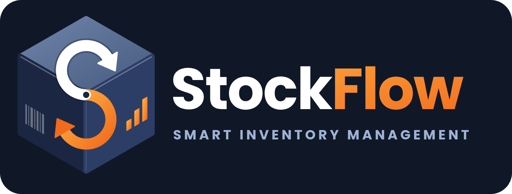

<p align="center">
  
</p>

<p align="center"><b>Smart inventory and stock management system</b></p>

StockFlow helps a small business know what it has, what is running low, and what to reorder. Every stock in and stock out is recorded, product quantities update automatically, and a dashboard shows the current picture at a glance.

## Platform direction

StockFlow is being developed as a scalable, multi-tenant inventory platform (small shops through multi-branch and warehouse operations), not only a single-shop app. Architecture decisions are in [`docs/adr/`](docs/adr/0001-architecture-decisions.md).

**StockFlow now has a working MVP:** a Python (FastAPI) API with registration, login and logout (Argon2id passwords, server-side sessions), workspaces with roles, products and an append-only stock ledger, all isolated per tenant by PostgreSQL row-level security, plus a web dashboard served from `backend/public`. Automated tests exist for every layer, but **they have not all been run on a real database yet**; see `DEPLOY.md` for the verification and deployment steps.

- `dashboard/` is the existing static prototype on sample data. It is **not** connected to a database or to the new API.
- `backend/` is the new production application foundation (API, migrations, tests).

## Features

- Dashboard with summary numbers: products, units in stock, low stock, out of stock
- Stock in and out chart for the last 7 days
- Needs restocking list with a Reorder button
- Product table with search and All / Low / Out filters
- Works on phone and laptop, with light and dark themes
- Database that blocks overselling and updates stock automatically

## Project status

| Part | Status |
| --- | --- |
| Brand and logo | Done |
| Dashboard UI | Done, runs on sample data (not yet connected to the database) |
| Database schema | Done, written for MySQL 8 |
| Backend API | Auth, workspaces and roles, products with categories and SKU conventions, stock ledger, suppliers and purchase orders, reports, insights and reorder suggestions, activity log, API keys, CSV export and bulk product import, plans and usage limits |
| Dashboard (`backend/public`) | Responsive, light/dark; inventory, purchasing, insights, reports, team and settings |
| Tests | Written; run them per `DEPLOY.md` before relying on them |

## Project structure

```
stockflow/
├── README.md
├── schema.sql      original MySQL prototype schema (unchanged)
├── assets/         logo, banner, favicon files (unchanged)
├── dashboard/      existing static prototype (not connected to any database or API)
├── legacy/         reference copy of the MySQL schema
├── backend/        NEW production API foundation (Python / FastAPI)
│   ├── app/        config, db (tenant_tx), errors, money, health route
│   ├── migrations/ Alembic migrations (PostgreSQL)
│   ├── scripts/    init_env, bootstrap_db, ci
│   └── tests/      unit, integration, tenant-isolation and guard tests
├── docs/adr/       architecture decision records
└── docker-compose.yml, Dockerfile, .env.example
```

## Development foundation (Phase 0, Python)

Needs Python 3.12 and Docker Desktop. Windows `cmd`, from the repository root:

```
cd backend
py -3.12 -m venv .venv
.venv\Scripts\activate
pip install -e ".[dev]"
python -m scripts.init_env
docker compose -f ..\docker-compose.yml up -d --wait db mailpit
python -m scripts.bootstrap_db
alembic upgrade head
uvicorn app.main:create_app --factory --reload
```

Then open http://127.0.0.1:8000/health (it returns `{"status":"ok"}`).

Checks (inside `backend`): `ruff check .`, `pytest -m "not db"`, `pytest -m "db and not rls and not guard"`, `pytest -m rls`, `pytest -m guard`. The whole pipeline: `python -m scripts.ci`.

The API connects as the restricted `stockflow_app` role (no BYPASSRLS, owns nothing, no DDL). Migrations use the separate owner role and are never run by the API. The MySQL steps below apply only to the original prototype schema.

## Setup

### 1. Get the project

```bash
git clone https://github.com/<your-username>/stockflow.git
cd stockflow
```

### 2. Run the dashboard

No install needed. Open `dashboard/index.html` in a browser by double-clicking it.

To serve it locally instead:

```bash
cd dashboard
python3 -m http.server 8000
```

Then open http://localhost:8000.

### 3. Create the database

You need MySQL 8 or newer.

```bash
mysql -u root -p < schema.sql
```

This creates the `stockflow` database, all tables, triggers, a status view, and a few sample rows. Check it worked:

```sql
USE stockflow;
SELECT * FROM v_product_status;
```

Try a stock movement. The product quantity updates by itself:

```sql
INSERT INTO stock_movements (product_id, user_id, type, quantity, note)
VALUES (1, 1, 'OUT', 5, 'Test sale');
```

Trying to take out more than what is in stock gives the error "Not enough stock for this product".

### 4. Put the dashboard online (optional)

1. Push the repository to GitHub.
2. Open Settings, then Pages.
3. Choose the `main` branch and the root folder, then Save.
4. After a minute the dashboard is live at `https://<your-username>.github.io/stockflow/dashboard/`.

## Database overview

| Table | Purpose |
| --- | --- |
| `users` | People who log in (admin, manager, staff) |
| `categories` | Product groups |
| `suppliers` | Who you buy from |
| `products` | Items, current quantity and minimum level |
| `stock_movements` | Every stock in and out |
| `purchase_orders` and `purchase_order_items` | Reorders sent to suppliers |

A product is **Out** at 0 units, **Low** at or below its minimum level, and **In stock** otherwise.

## Roadmap

- [ ] Backend API (login, products, movements, reorders)
- [ ] Connect the dashboard to the database
- [ ] Barcode scanning
- [x] CSV import (file upload, column matching, dry-run check, per-row report) and CSV export
- [ ] Email alerts for low stock

## Brand

| | |
| --- | --- |
| Navy | `#1B2742` |
| Slate blue | `#2C3E66` |
| Orange | `#F26A1B` to `#FFB547` |
| Font | Poppins |

Which logo file to use:

- White background: `assets/logo-horizontal.png`
- Dark background: `assets/logo-horizontal-dark.png`
- Unknown background: `assets/logo-any-background.png`
- App icon: `assets/logo-icon-512.png`
- Favicon: `assets/favicon.ico`

## Author

Muhammad Ramzan

## Deploying

See [`DEPLOY.md`](DEPLOY.md) for the Neon, GitHub and Vercel steps and the production checklist.

## Recent additions

- **Enterprise direction**: `docs/ENTERPRISE-PLATFORM.md` is the blueprint for one platform serving wholesale and distribution, manufacturing and multi-branch retail: honest gap analysis of the current code, architecture, industry packs, security, scale targets and a phased roadmap (E0 to E6).
- **Planning tab (first enterprise capability)**: ABC and XYZ classes, safety stock (demand and lead-time variability), reorder point, order-up-to level and overstock flags from units issued, with paging for large catalogues (`GET /api/v1/planning`).
- **Import reads almost any data file**: Excel (.xlsx, .xlsm), OpenDocument (.ods), Word (.docx), PowerPoint (.pptx) and PDF tables (PDFs with real text, not scans), CSV, TSV, pipe or semicolon text, JSON (list, wrapped list, JSON Lines), XML, HTML tables and Markdown tables. The file content decides, not its name. Old .xls, .doc, .ppt, scanned PDFs and pictures cannot be read in a browser; the dialog says so and what to do instead. Files are read inside the browser and are never uploaded; only the checked rows go to the server.
- **Phone header**: Owner, bell and the three-line menu share one row at equal height, the workspace select and "+ Workspace" are two equal boxes, and Theme and Log out moved into the menu. The extra Alerts chip is gone (the bell does that job).
- **Import any data file**: Excel (.xlsx), CSV, TSV, text with commas, semicolons or pipes, JSON, JSON Lines, XML, HTML tables, Markdown tables, Word (.docx) tables and OpenDocument (.ods). The file content decides the format, not its name. Everything is read inside the browser (`public/importers.js`, no libraries). Old .xls, PDF and pictures cannot be read reliably; the dialog says how to convert them.
- **Phone header**: Owner, bell and the three-line menu share one row; workspace and "+ Workspace" are two equal boxes; Theme and Log out are inside the menu; the Alerts chip is gone (the bell does that job).
- **Dashboard (new home screen)**: welcome banner, four KPI cards with 7-day trend and sparkline, a stock overview chart (7, 14 or 30 days) and recent activity, plus a search box (Ctrl+K), notification bell and account menu in the header. On phones: app-icon tiles, 2x2 KPI cards and a bottom tab bar. Every number is derived from your own records (stock levels are rebuilt backwards from today's level using the movement history), nothing is hard-coded. The upgrade card and banner show only on the free plan.
- **Glass design**: floating translucent header, frosted sidebar on desktop (tile grid on phones), layered glass cards and dialogs, glossy orange primary buttons, light and dark themes. Text contrast was checked (navy label on orange reaches 5.3 to 7.8, white would only reach 3.1). Falls back to solid surfaces for `prefers-reduced-transparency` and browsers without `backdrop-filter`, and blur is lighter on phones.
- **3D stock view**: orbit camera that always fits its canvas, gentle idle sway, drag to rotate. It no longer disappears for an empty workspace (it shows an invitation instead).
- **Automatic full tests on GitHub**: `.github/workflows/full-tests.yml` runs every test, including the database tests, on a throw-away PostgreSQL on each push. Nothing has to be run locally.
- **Bootstrap fix**: `scripts.bootstrap_db` now creates the local database (owned by `stockflow_owner`) instead of failing when it does not exist; migrations need that ownership to create the `app` schema.
- **Sales tab**: customers, sales orders that reserve stock (no overselling), ship (books OUT movements) and cancel (frees the reservation), plus a live availability table. The API (`/api/v1/customers`, `/sales-orders`, `/sales/availability`) and migration 0010 were already in place; this adds the screen and tests.
- **Bulk import**: Inventory, Import file. CSV or JSON, column matching, a dry-run check, then import with a per-row report (`POST /api/v1/products/import`).
- **3D stock bars**: drawn on a canvas, no library (the CSP allows only our own scripts).
- **Assistant tab**: answers about reorders, fast and slow sellers, forecasts and unusual stock-outs from your own records, using fixed rules (not a language model). It only reads data.
- **Calculator tab**: profit and margin, markup, discount, tax or VAT, break-even.
- **Mobile**: tabs wrap into a grid and tables turn into cards, so there is no sideways scrolling.
- Node tests for the browser code: `node --test backend/tests/js/tools.test.mjs backend/tests/js/app.smoke.test.mjs` (also run by `pytest` when Node is installed).

