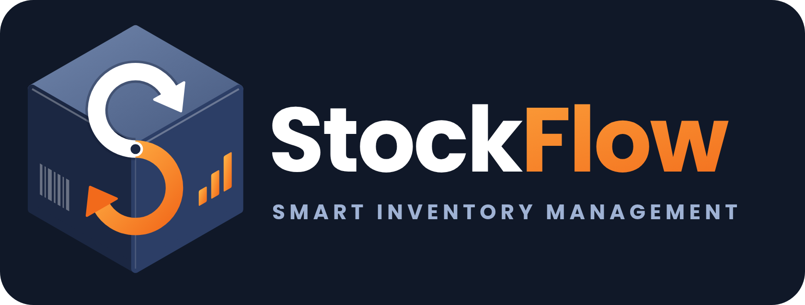

  

  <strong>StockFlow — Smart Inventory & Stock Management</strong> 
  Track inventory. Control stock movement. Make better replenishment decisions.

  <a href="https://github.com/Rztech15/StockFlow">GitHub Repository</a> ·
  <a href="https://stock-flow-api-iota.vercel.app">Live API</a> ·
  <a href="https://stock-flow-api-iota.vercel.app/health">API Health Check</a>

---

Overview

StockFlow is an inventory management system designed to help businesses manage products, monitor stock levels, record inventory movements, and make informed restocking decisions.

The project is evolving from a static dashboard prototype into a multi-tenant platform intended to support small businesses and, in the future, multi-location and warehouse operations.

Key Features

- Inventory Dashboard: View product counts, available stock, low-stock items, and out-of-stock products.
- Stock Management: Record stock-in and stock-out movements with an inventory history.
- Product Management: Organize products using categories, units, and SKU conventions.
- Smart Reordering: View low-stock products and suggested reorder quantities.
- Supplier Management: Maintain supplier information and manage purchase orders.
- Inventory Insights: Review demand estimates, supplier lead-time analysis, and rule-based recommendations.
- Reports and Exports: Access reports, activity history, and supported CSV exports.
- Team Workspaces: Support workspace roles such as owner, admin, manager, staff, and viewer.
- API Access: Use scoped API keys for supported operations.
- Responsive UI: Designed for mobile and desktop, with light, dark, and automatic themes.

Technology Stack

Technology| Purpose
Python| Backend programming language
FastAPI| REST API framework
PostgreSQL| Database for the new backend
Alembic| Database migrations
Argon2id| Password hashing
Server-side sessions| Authentication session management
PostgreSQL RLS| Tenant data isolation
pytest| Automated testing
Vercel| API deployment
MySQL 8| Original prototype schema

Architecture note: The original MySQL schema and static dashboard are retained as prototype assets. The newer backend uses PostgreSQL; these components are not yet connected as one complete application.

Architecture and Security

StockFlow is designed around several important engineering principles:

- Multi-tenancy: Separate business workspaces within a shared application.
- Database-level isolation: PostgreSQL Row-Level Security helps enforce tenant boundaries.
- Inventory ledger: Preserve a history of stock movements.
- Stock integrity: Protect against stock quantities falling below zero.
- Role-based access: Control supported actions according to workspace roles.
- Restricted database permissions: Use a restricted application role and a separate migration role.
- Environment configuration: Keep credentials and application secrets outside source code.

These design choices do not constitute independent security certification. Complete the database and deployment verification steps before using the application with real business data.

Project Structure

StockFlow/
├── assets/          # Logo, banner, app icon, favicon
├── dashboard/       # Original static dashboard prototype
├── backend/         # FastAPI application, migrations, tests
├── docs/adr/        # Architecture decisions
├── legacy/          # Reference MySQL schema
├── schema.sql       # Original MySQL prototype schema
├── docker-compose.yml
├── Dockerfile
├── .env.example
├── DEPLOY.md        # Deployment and verification guide
└── README.md

Project Status

Component| Status
Branding and logo| Available
Static dashboard| Available; uses sample data
FastAPI backend| Implemented application foundation
Authentication and workspaces| Included in backend
Inventory and purchasing| Included in backend scope
Reports and insights| Included in backend scope
PostgreSQL migrations| Managed with Alembic
Automated tests| Written; execution and verification required
Full end-to-end integration| Requires further verification

Important: The existing "dashboard/" prototype is not connected to the new backend. The backend's complete database and deployment workflow must be tested before treating the project as production-ready.

Live Deployment

- API Base URL: https://stock-flow-api-iota.vercel.app
- Health Endpoint: https://stock-flow-api-iota.vercel.app/health
- Source Code: https://github.com/Rztech15/StockFlow
- Deployment Guide: "DEPLOY.md" (DEPLOY.md)

The API URL is the backend deployment, not a confirmed public dashboard demo. The static dashboard remains separate.

Installation and Local Setup

Prerequisites

- Python 3.12
- Docker Desktop
- Git

1. Clone the repository

git clone https://github.com/Rztech15/StockFlow.git
cd StockFlow

2. Create a virtual environment

On Windows Command Prompt:

cd backend
py -3.12 -m venv .venv
.venv\Scripts\activate
pip install -e ".[dev]"

On macOS or Linux:

cd backend
python3.12 -m venv .venv
source .venv/bin/activate
pip install -e ".[dev]"

3. Configure the environment and database

Run from the "backend/" directory with the virtual environment active:

python -m scripts.init_env
docker compose -f ../docker-compose.yml up -d --wait db mailpit
python -m scripts.bootstrap_db
alembic upgrade head
uvicorn app.main:create_app --factory --reload

Open:

http://127.0.0.1:8000/health

A healthy local API should return:

{"status":"ok"}

For environment configuration and deployment safeguards, follow "DEPLOY.md" (DEPLOY.md).

Testing

Run these commands from "backend/":

ruff check .
pytest -m "not db"
pytest -m "db and not rls and not guard"
pytest -m rls
pytest -m guard
python -m scripts.ci

Safety: Database tests can modify test tables. Use a dedicated development/test database and follow the safeguards in "DEPLOY.md". Never run database tests against production data.

Original MySQL Prototype

The root-level "schema.sql" belongs to the original prototype and targets MySQL 8 or newer.

To initialize that prototype:

mysql -u root -p < schema.sql

This is separate from the PostgreSQL-backed application setup.

Known Limitations

- The static dashboard is not connected to the new backend.
- Full database testing and end-to-end deployment verification remain necessary.
- Email verification, password reset, invitations, and outbound email notifications are not fully implemented.
- Payment processing is not connected.
- Direct integrations with external accounting and e-commerce platforms are not included.
- CSV export is supported; CSV import is not yet implemented.
- Inventory insights use statistical and rule-based logic, not a third-party AI model.

See "DEPLOY.md" (DEPLOY.md) for the detailed deployment checklist and additional limitations.

Brand Identity

Element| Value
Navy| "#1B2742"
Slate Blue| "#2C3E66"
Orange Gradient| "#F26A1B" → "#FFB547"
Typeface| Poppins

Existing logo assets:

- General background: "assets/logo-any-background.png"
- White background: "assets/logo-horizontal.png"
- Dark background: "assets/logo-horizontal-dark.png"
- App icon: "assets/logo-icon-512.png"
- Favicon: "assets/favicon.ico"

Author

Muhammad Ramzan

- GitHub: "@Rztech15" (https://github.com/Rztech15)
- Project: "StockFlow" (https://github.com/Rztech15/StockFlow)

---

  <strong>StockFlow — Clearer Inventory. More Reliable Stock Records.</strong>

